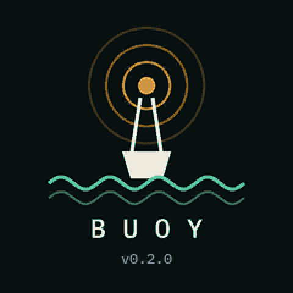
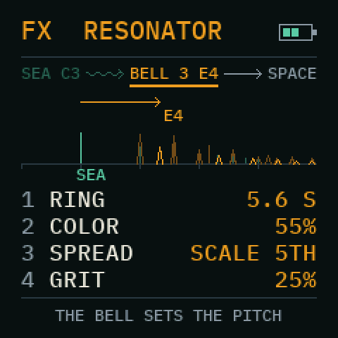
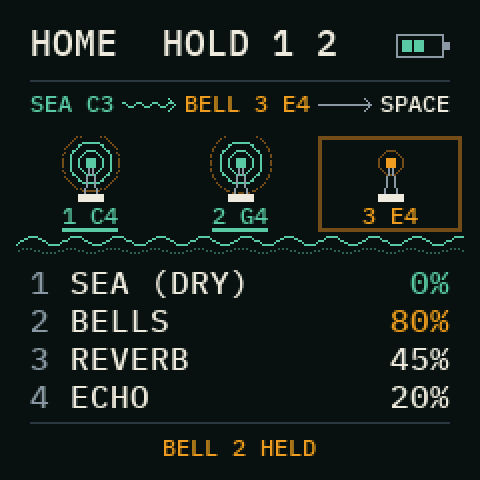
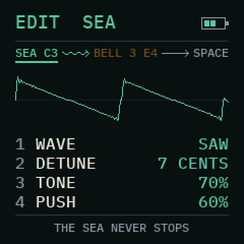

# BUOY

  
  

  
  

> [!WARNING]
> **Not tested on a real FM‑1 yet.** BUOY has only been tested on a computer. Install it on your FM‑1 at your own risk, and keep the stock firmware or another firmware ready to flash back.

BUOY is a firmware for the **M‑VAVE FM‑1**, for exploration and drones, where **the effects are the synth**.

A bell buoy rings because the sea never stops moving. In BUOY the sea is an oscillator that never stops, always
on the scale's root. The keys do not play it: they retune three **bells**, effects the sea runs through. The bell
picks the pitch out of the sea, the envelope decides how much sea reaches it, and the bell rings on after that.

- **The sea (EDIT)**: sine, triangle, saw, square, glass, reed, voice, organ or noise; a second oscillator to detune; tone and push.
- **Three bells, three effects (ALGORITHM)**: **RESONATOR** (a tuned delay that rings at the note), **SHIFTER** (grains of the sea, played faster or slower: the sea moved to the note; feedback stacks the interval into a shimmer) and **PRISM** (narrow filters on the note and its overtones). The same four knobs for all three: RING, COLOR, SPREAD, GRIT.
- **ENV, LFO, ARP, SEQ and the scale all play the bells**, never the oscillator. RELEASE goes to FOREVER, and **SEL holds** any of the three bells, in any combination, while you play over them.
- **A normal ARP** (hold keys and it plays them) and **one 32-step SEQ** with rests and ties, recorded LIVE, STEP by step, or from the ARP. Nothing is saved.
- **The scale comes last**: 48 scales, common and exotic, and some only the bells can play: slendro, just major, the harmonic series. On the GLO page the keys transpose everything, held drones and the sea too.
- **The signal path is on every screen**: `SEA C3 ~> BELL 1 G4 -> SPACE`. The sea's note never moves; the bell's does.
- **8 presets and 8 USER slots** that SAVE keeps. Reverb and echo. MIDI in and out (bells 1 to 3 on channels 1 to 3) with clock.
- **Every button does what it says**, one page each, no menus inside menus.

[Read the operator manual](docs/OPERATOR-MANUAL.md) · [Build and test](docs/BUILDING.md) · [Credits and licenses](LICENSING.md)

**Version 0.2.0** builds as `buoy_0.2.0.fwsc`. The host tests pass. It has **not yet been installed on a physical
FM‑1**.

## Credits

BUOY builds on [Dinghy](https://github.com/zvenson/dinghy) by zvenson and the
[Felucca](https://github.com/hugelton/Felucca) and [SLOOP](https://github.com/isod89/sloop-fm1)
platform work it carries, and on the delay, hall and page design of
[LOOPHEADS](https://github.com/jaak-stjaaques/LOOPHEADS-public) and
[BEACHCOMBER](https://github.com/jaak-stjaaques/Beachcomber). The screen font is
[IBM Plex Mono](https://github.com/IBM/plex).

The firmware is distributed under [GPL-3.0-only](LICENSE). The
[full credits](LICENSING.md) retain the upstream notices and list the separately
licensed assets.
